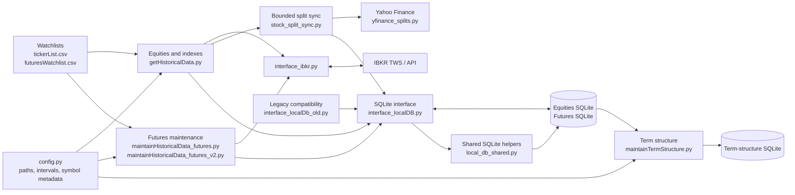
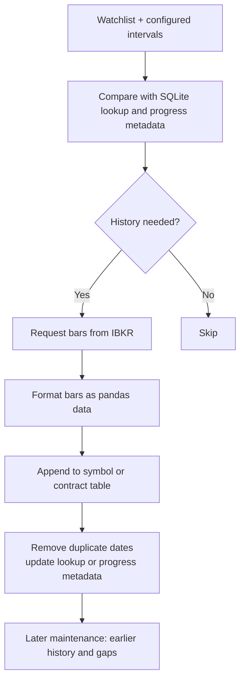

# System architecture

This repository is a collection of Python scripts that download historical equities, indexes, and futures prices from IBKR through `ib_insync`, store them in SQLite, and derive futures term structures. The scripts share configuration and interface modules; they have separate entry points rather than one application process.

## Components

### Collection and storage

- **Equities and indexes:** [`getHistoricalData.py`](../getHistoricalData.py) reads the ticker watchlist, compares it with SQLite metadata, and fetches new or stale history. It also has a backward history pass. On an NYSE trading day, a running pass yields after its current saved IBKR request when 5:15 p.m. New York time is reached, refreshes current records once, and resumes from persisted progress. It uses [`interface_localDB.py`](../interface_localDB.py) for database access.
- **Futures:** [`maintainHistoricalData_futures.py`](../maintainHistoricalData_futures.py) handles contract discovery, history updates, and gap work. [`maintainHistoricalData_futures_v2.py`](../maintainHistoricalData_futures_v2.py) is another maintenance entry point; it queues work by contract and interval and records progress in `00-progress_tracker`.
- **IBKR access:** [`interface_ibkr.py`](../interface_ibkr.py) connects to local TWS, constructs stock, index, and futures requests, retrieves historical bars, and paces requests.
- **Split history:** [`stock_split_sync.py`](../stock_split_sync.py) selects tracked non-index symbols from the equity watchlist and existing stock tables. At startup and during each bulk-update cycle it checks up to 50 due symbols or runs for 120 seconds, whichever comes first. A successful symbol is due again after 24 hours. Yahoo requests are at least one second apart. The provider-wide exponential cooldown after a rate limit is persisted, so IBKR history work can continue and a later cycle or run can resume split checks. [`yfinance_splits.py`](../yfinance_splits.py) fetches and validates Yahoo's full split history.
- **SQLite access:** [`interface_localDB.py`](../interface_localDB.py) writes price history, removes duplicate dates, and updates lookup metadata. [`interface_localDb_old.py`](../interface_localDb_old.py) forwards legacy calls to it. Shared connection, date, string, and exchange lookup helpers live in [`local_db_shared.py`](../local_db_shared.py). [`db_utils.py`](../db_utils.py) contains additional database maintenance utilities. Price-history tables are named by symbol, instrument type or futures expiry, and interval, such as `SPY_stock_1day` or `ES_202612_1day`.

Split data is stored in the equities database in `00-split_events` (dates, ratios, source, observation times, and omission flags), `00-split_sync` (per-symbol attempts and successful checks), and `00-split_provider_state` (Yahoo cooldown). Successful full responses update ratios and flag prior events omitted by Yahoo without deleting them. Empty responses record a successful check. Yahoo errors leave events intact. The `00-` prefix excludes these tables from price-table discovery. Split sync does not read, audit, adjust, or replace OHLCV rows; the existing IBKR `TRADES` request and price write flow are unchanged.

## Historical data flow

The two futures maintenance scripts use different control flows. The v2 script persists contract and interval status in `00-progress_tracker` so its queue can resume across runs. The diagram shows their shared data path, not a single execution sequence followed by every script.

## Derived data and consumers

[`maintainTermStructure.py`](../maintainTermStructure.py) reads stored futures contracts, uses expiry and roll settings in [`config.py`](../config.py), builds term-structure rows, and saves them to a separate SQLite database. [`checkDataIntegrity.py`](../checkDataIntegrity.py) supplies missing-date checks used by futures and term-structure work. [`realtime_monitor.py`](../realtime_monitor.py) and [`backtest.py`](../backtest.py) are other data consumers outside the main historical collection flow.

Database and watchlist locations come from `config.py`. Its current equities and futures database paths point to `X:/data/ibkr`, while its term-structure path uses `/workbench/...`. Check these paths before running a script that can write data.
