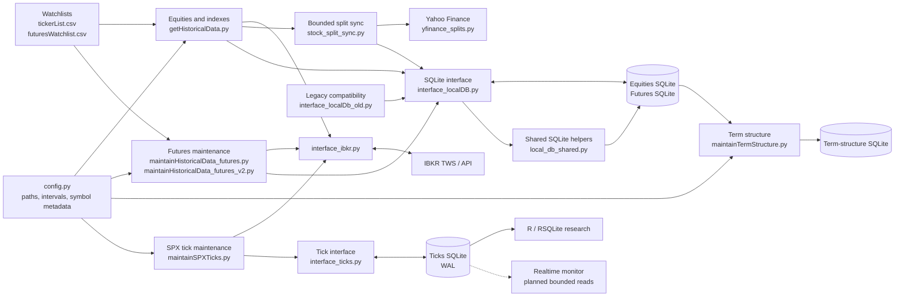
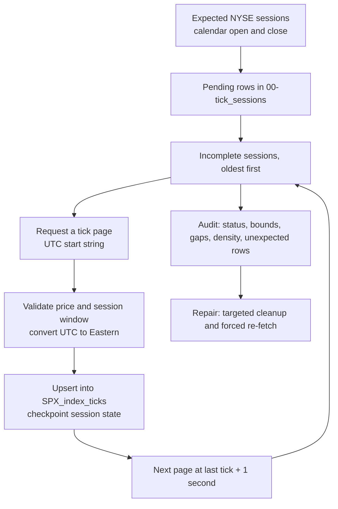
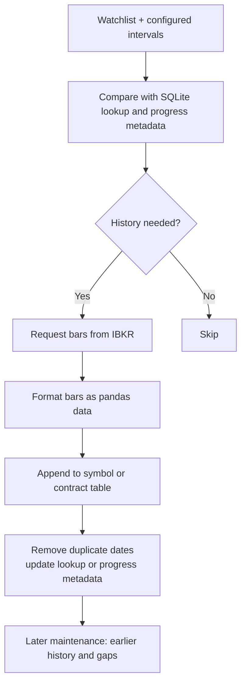

# System architecture

This repository is a collection of Python scripts that download historical equities, indexes, and futures prices from IBKR through `ib_insync`, store them in SQLite, derive futures term structures, and collect SPX index ticks into a separate SQLite database. The scripts share configuration and interface modules; they have separate entry points rather than one application process.

## Components



### Collection and storage

- **Equities and indexes:** [`getHistoricalData.py`](../getHistoricalData.py) reads the ticker watchlist, compares it with SQLite metadata, and fetches new or stale history. It also has a backward history pass. On an NYSE trading day, a running pass yields after its current saved IBKR request when 5:15 p.m. New York time is reached, refreshes current records once, and resumes from persisted progress. It uses [`interface_localDB.py`](../interface_localDB.py) for database access.
- **Futures:** [`maintainHistoricalData_futures.py`](../maintainHistoricalData_futures.py) handles contract discovery, history updates, and gap work. [`maintainHistoricalData_futures_v2.py`](../maintainHistoricalData_futures_v2.py) is another maintenance entry point; it queues work by contract and interval and records progress in `00-progress_tracker`.
- **IBKR access:** [`interface_ibkr.py`](../interface_ibkr.py) connects to local TWS, constructs stock, index, and futures requests, retrieves historical bars, and paces requests.
- **Split history:** [`stock_split_sync.py`](../stock_split_sync.py) selects tracked non-index symbols from the equity watchlist and existing stock tables. At startup and during each bulk-update cycle it checks up to 50 due symbols or runs for 120 seconds, whichever comes first. A successful symbol is due again after 24 hours. Yahoo requests are at least one second apart. The provider-wide exponential cooldown after a rate limit is persisted, so IBKR history work can continue and a later cycle or run can resume split checks. [`yfinance_splits.py`](../yfinance_splits.py) fetches and validates Yahoo's full split history.
- **SQLite access:** [`interface_localDB.py`](../interface_localDB.py) writes price history, removes duplicate dates, and updates lookup metadata. [`interface_localDb_old.py`](../interface_localDb_old.py) forwards legacy calls to it. Shared connection, date, string, and exchange lookup helpers live in [`local_db_shared.py`](../local_db_shared.py). [`db_utils.py`](../db_utils.py) contains additional database maintenance utilities. Price-history tables are named by symbol, instrument type or futures expiry, and interval, such as `SPY_stock_1day` or `ES_202612_1day`.
- **SPX index ticks:** [`maintainSPXTicks.py`](../maintainSPXTicks.py) collects event-driven SPX ticks from IBKR historical tick requests into its own SQLite file. It does not write the equities or futures databases, and the bar collectors do not discover or alter tick tables. See [SPX tick history](#spx-tick-history).

Split data is stored in the equities database in `00-split_events` (dates, ratios, source, observation times, and omission flags), `00-split_sync` (per-symbol attempts and successful checks), and `00-split_provider_state` (Yahoo cooldown). Successful full responses update ratios and flag prior events omitted by Yahoo without deleting them. Empty responses record a successful check. Yahoo errors leave events intact. The `00-` prefix excludes these tables from price-table discovery. Split sync does not read, audit, adjust, or replace OHLCV rows; the existing IBKR `TRADES` request and price write flow are unchanged.

### SPX tick history

[`maintainSPXTicks.py`](../maintainSPXTicks.py) requests SPX index ticks with `reqHistoricalTicks` (`TRADES`, regular hours, 1,000 ticks per request) and stores them in a separate SQLite database, `X:/data/ibkr/historicalData_ticks.db` (`config.dbname_ticks`). The file uses WAL, `synchronous=NORMAL`, and a 5-second busy timeout, so R/RSQLite readers can query it while a collector writes; an intended monitor reader could use the same path once wired. Read-only commands open a `mode=ro` URI with `PRAGMA query_only=ON`.

[`interface_ticks.py`](../interface_ticks.py) owns the schema and queries:

- `SPX_index_ticks` (`date TEXT PRIMARY KEY`, `price REAL`, `WITHOUT ROWID`) is the canonical tick table. Tables are named `<symbol>_index_ticks`; the clustered primary key makes date-range scans contiguous. There are no bar, symbol, or size columns, and no bars are derived or forward-filled.
- `00-tick_sessions` is the expected-session state table keyed by `(symbol, session_date)`: calendar open and close, `status`, row count, first and last tick, request and attempt counts, last error, and fetch time. Statuses are `pending`, `in_progress`, `retry`, `complete`, `partial`, `unavailable`, and `failed`. Audit uses this table plus the tick rows; it does not infer completeness from `MAX(date)` alone.

`date` is naive Eastern time text in `YYYY-MM-DD HH:MM:SS`, matching the existing bar tables, so joins and comparisons need no conversion. IBKR request start strings use UTC notation (`YYYYMMDD-HH:MM:SS`). Provider timestamps are UTC-aware and are converted to `America/New_York` before storage, so the TWS timezone setting does not change the result. `00-tick_sessions` uses the same Eastern text for its open, close, first, and last values.

The collector creates one pending state row per expected NYSE session, fetches each incomplete session in ascending date order, and checkpoints each page in its own transaction. An `in_progress` session resumes from `last_tick + 1 second`; a `complete` or `unavailable` session is skipped unless repair forces it. A session is `complete` when its last tick reaches the close within the configured tolerance, `partial` when it ends earlier, and `unavailable` after the configured attempts return no data. Request errors stop the run, reconnect and retry the page, or fail the session for a later attempt depending on the IBKR error code.



Audit compares expected sessions with stored rows. Errors are missing or incomplete sessions, early ends, gaps of 30 minutes or more, invalid prices, and rows outside the session window or on a non-trading day. Warnings are a first tick more than 5 minutes after the open, gaps of 10 minutes or more, and density below half the trailing 20-session median. `unavailable` sessions are informational because the provider retention boundary is an expected outcome. `--strict` turns warnings into a failing exit code.

Repair audits first, deletes invalid prices and out-of-window rows inside the selected range, then re-fetches the selected sessions through the normal upsert path. A session's valid rows are not deleted before the re-fetch, so an interrupted repair leaves the existing rows in place. The exit code is the post-repair audit's.

Run the maintenance commands from this directory:

```powershell
..\venv\Scripts\python.exe maintainSPXTicks.py --backfill
..\venv\Scripts\python.exe maintainSPXTicks.py --daily
..\venv\Scripts\python.exe maintainSPXTicks.py --audit --start 2026-01-01 --end 2026-11-18
..\venv\Scripts\python.exe maintainSPXTicks.py --repair --start 2026-01-01 --end 2026-11-18
..\venv\Scripts\python.exe maintainSPXTicks.py --status
```

- `--backfill` fills every incomplete session in the inclusive range. The default range is three years back through the latest completed NYSE session; `--start`, `--end`, and `--max-runtime-minutes` override it. The runtime limit stops before the next session when the budget is exhausted, so repeated runs resume where the previous one stopped. This is the command for the initial multi-day backfill.
- `--daily` has its own window: it discovers the last 14 calendar days but only processes incomplete sessions whose close passed within the last 7 calendar days. It does not use `--start`, `--end`, or `--max-runtime-minutes`. Schedule it after the bar collector on trading days.
- `--audit` is read-only. It exits 1 when any error is present; `--strict` also exits 1 on warnings.
- `--repair` audits and re-fetches session errors. `--include-warnings` adds warnings and `--force-unavailable` retries informational `unavailable` sessions.
- `--status` is read-only and reports status counts, complete-session bounds, total rows, and database size.
- `--db-path` selects another database file. Tests and smoke runs must use a temporary path.

Every command exits 1 and logs an error line when it fails, including a refused IBKR connection or a dropped socket, so an unattended scheduler does not treat a failed run as success.

A single-instance lock at `<absolute db path>.lock` stops two tick writers, so relative and absolute spellings of the same database share one lock. It does not coordinate with the bar or futures collectors. IBKR's historical-data pacing budget is shared at the account level, so do not run `--backfill`, `--daily`, or `--repair` while `getHistoricalData.py` or a futures maintenance script is making requests. Run the initial backfill when those collectors are idle, and run `--daily` after the bar collector finishes. The log is appended to `logs/spx_ticks_YYYYMMDD.log` in Eastern time.

### Tick read access

R with RSQLite reads the tick database directly today; the realtime monitor is an intended reader once its tick read path is wired. WAL permits reads during a collector run. Bound every query by date: a full three-year scan is about 17.7 million rows.

```r
library(DBI)
library(RSQLite)

con <- dbConnect(SQLite(), "X:/data/ibkr/historicalData_ticks.db")
on.exit(dbDisconnect(con), add = TRUE)

ticks <- dbGetQuery(
  con,
  "SELECT date, price
     FROM SPX_index_ticks
    WHERE date >= ? AND date < ?
    ORDER BY date",
  params = list("2026-11-18 09:30:00", "2026-11-18 16:00:00")
)
ticks$date <- as.POSIXct(ticks$date, tz = "America/New_York")
```

Use `flags = RSQLite::SQLITE_RO` to enforce read-only access, and `dbFetch(n = 100000)` for large results instead of materialising a whole table. Bar joins attach the equities database:

```r
dbExecute(con, "ATTACH DATABASE 'X:/data/ibkr/historicalData_index.db' AS px")
dbGetQuery(con, "
  SELECT t.date, t.price, b.close
    FROM SPX_index_ticks t
    LEFT JOIN px.SPX_index_1min b
      ON b.date = substr(t.date, 1, 17) || '00'
   WHERE t.date >= '2026-11-18 09:30:00'
     AND t.date <  '2026-11-18 16:00:00'
")
```

Each tick maps to its containing minute bar, so the tick timestamp must be bucketed to the bar's minute. Bar dates are minute-aligned while ticks are event-driven; joining `b.date = t.date` directly would match only ticks that fall exactly on a bar timestamp.

In Python, `interface_ticks.get_ticks(conn, start, end)` returns a sorted `date, price` DataFrame with parsed dates for bounded windows. The realtime monitor does not read ticks yet; it can use this helper or an equivalent bounded query when that read path is added, and it must not load the full table for z-scores.

## Historical data flow



The two futures maintenance scripts use different control flows. The v2 script persists contract and interval status in `00-progress_tracker` so its queue can resume across runs. The diagram shows their shared data path, not a single execution sequence followed by every script.

## Derived data and consumers

[`maintainTermStructure.py`](../maintainTermStructure.py) reads stored futures contracts, uses expiry and roll settings in [`config.py`](../config.py), builds term-structure rows, and saves them to a separate SQLite database. [`checkDataIntegrity.py`](../checkDataIntegrity.py) supplies missing-date checks used by futures and term-structure work. [`realtime_monitor.py`](../realtime_monitor.py) and [`backtest.py`](../backtest.py) are other data consumers outside the main historical collection flow. R/RSQLite reads the tick database today through bounded windows; the realtime monitor is an intended tick reader and can use `interface_ticks.get_ticks` when that path is wired. See [Tick read access](#tick-read-access).

Database and watchlist locations come from `config.py`. Its current equities, futures, and tick database paths point to `X:/data/ibkr`, while its term-structure path uses `/workbench/...`. Check these paths before running a script that can write data.
